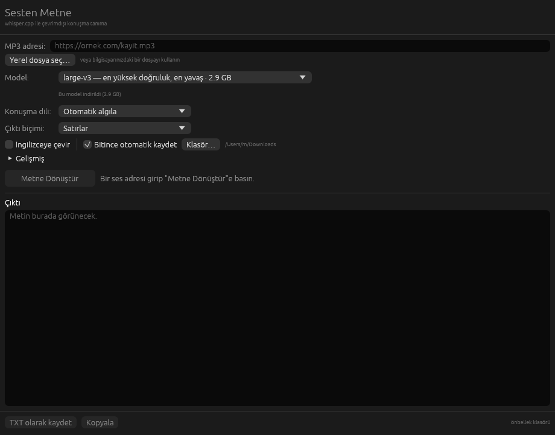

# Sesten Metne

[](https://github.com/mhmtskrc2/speech_to_text/actions/workflows/ci.yml)

Bir MP3 adresi (veya yerel ses dosyası) alıp metne çeviren, whisper.cpp tabanlı
masaüstü uygulaması. macOS ve Windows'ta çalışır, Rust ile yazılmıştır.

Her şey **çevrimdışı ve yerelde** çalışır: ses hiçbir buluta gönderilmez.
Tek ağ erişimi, girdiğiniz ses adresini indirmek ve gerekli modeli ilk
kullanımda çekmek içindir.



## Ne yapar

1. Verdiğiniz adresten sesi indirir.
2. Seçtiğiniz whisper modelini **ilk ihtiyaç duyulduğunda** indirip önbelleğe alır.
3. Sesi mono 16 kHz'e çözümler.
4. whisper.cpp ile metne döker ve `.txt` olarak kaydeder.

Çıktı biçimleri:

| Biçim | Nasıl görünür |
|---|---|
| **Satırlar** (varsayılan) | Her konuşma parçası kendi satırında, zaman damgası yok |
| Düz metin | Tek paragraf |
| Zaman damgalı metin | `[00:00:03,680 --> 00:00:08,240] metin` |
| SRT altyazı | Standart `.srt` dosyası |

Satır kırılmaları whisper'ın doğal duraklamalara göre ayırdığı yerlerden gelir,
sabit bir satır genişliğinden değil; bu yüzden okuması ve alıntılaması kolaydır.

## Hazır indirmeler

Rust kurmanıza gerek yok. [Releases](https://github.com/mhmtskrc2/speech_to_text/releases)
sayfasından kendi sisteminize uyan paketi indirin:

| İndirme | Kimin için |
|---|---|
| `Sesten-Metne-GPU.exe` | Windows + ekran kartı (NVIDIA / AMD / Intel) — **hızlı** |
| `Sesten-Metne.exe` | Windows, ekran kartı sürücüsü olmayan makineler |
| `sesten-metne-macos` | Tüm Mac'ler — evrensel ikili, Metal hızlandırmalı |

Windows'ta iki dosya olmasının sebebi teknik bir zorunluluk: GPU sürümü
`vulkan-1.dll`'e yükleme zamanında bağlanır, o da ekran kartı sürücüsüyle
gelir. Sürücüsü olmayan bir makinede GPU sürümü hiç açılmaz, bu yüzden CPU
sürümü ayrı duruyor. **Önce GPU sürümünü deneyin**; açılmazsa CPU sürümünü
indirin. Uygulamanın "Gelişmiş" bölümündeki *Hızlandırma:* satırı hangi
aygıtın kullanıldığını adıyla yazar.

**Windows'ta ilk açılış.** İndirip çalıştırın. SmartScreen uyarırsa **Ek
bilgi** → **Yine de çalıştır**. Açılmazsa
[Visual C++ Redistributable](https://aka.ms/vs/17/release/vc_redist.x64.exe)
kurup tekrar deneyin.

**macOS'ta ilk açılış.** İndirilen dosya tek bir ikilidir; tarayıcı çalıştırma
iznini düşürdüğü ve dosya imzalı olmadığı için bir kez şunu yapın:

```bash
chmod +x ~/Downloads/sesten-metne-macos
xattr -d com.apple.quarantine ~/Downloads/sesten-metne-macos
```

## Kaynaktan derleme

Gereksinimler: [Rust](https://rustup.rs) ve bir C/C++ derleyicisi + CMake
(whisper.cpp kaynaktan derlenir).

```bash
cargo build --release
```

Çalıştırmak için:

```bash
./target/release/whisper_gui
```

### Platform notları

| | Gerekenler |
|---|---|
| **macOS** | `xcode-select --install` ve `brew install cmake` |
| **Windows** | Visual Studio Build Tools (C++ iş yükü) ve CMake |
| **Linux** | `build-essential`, `cmake`, `libgtk-3-dev` |

### GPU hızlandırma

**macOS'ta Metal her zaman açıktır** — ayrı bir bayrak gerekmez, düz
`cargo build --release` yeterlidir. Arayüzde de bir seçenek yoktur: hızlandırma
varsa kullanılır, bir makinede Metal başlatılamazsa whisper.cpp kendiliğinden
CPU'ya düşer. Hangisinin geçerli olduğunu "Gelişmiş" bölümündeki
*Hızlandırma:* satırından görebilirsiniz.

Windows ve Linux'ta GPU, derleme zamanında SDK gerektirdiği için bir bayrağa
bağlıdır. Yayımlanan `Sesten-Metne-GPU.exe` Vulkan ile derlenir:

```bash
cargo build --release --features vulkan   # NVIDIA / AMD / Intel, Vulkan SDK gerekir
cargo build --release --features cuda     # yalnızca NVIDIA, CUDA toolkit gerekir
```

Dağıtılan pakette Vulkan tercih edilmesinin sebebi, çalışma zamanında yalnızca
ekran kartı sürücüsüyle gelen `vulkan-1.dll`'e ihtiyaç duyması: ikili tek dosya
kalıyor. CUDA daha hızlı olabilir ama Windows'ta statik `cublas` kütüphanesi
olmadığından yanında yüzlerce megabayt DLL taşımayı gerektirir.

> Windows'ta Vulkan derlerken iki tuzak var: iç içe CMake projesi yüzünden
> `CMAKE_GENERATOR=Ninja` ve vcvars ortamı gerekir, ayrıca uzun yol sınırı
> nedeniyle `CARGO_TARGET_DIR` kısa bir dizine (örn. `C:\g`) ayarlanmalıdır.
> İkisi de [release workflow'unda](.github/workflows/release.yml) hazır.

## Hız

Model seçimi süreyi doğrudan belirler. Apple Silicon bir Mac'te ölçülen,
**1 saatlik ses** için yaklaşık süreler:

| Model | Apple Silicon (Metal) | Yalnızca CPU |
|---|---|---|
| `base` | ~2 dakika | ~7 dakika |
| `large-v3-turbo (q5_0)` | ~5 dakika | ~26 dakika |
| `large-v3` | ~9 dakika | ~44 dakika |

(63 saniyelik Türkçe bir kayıtla ölçülüp bir saate oranlandı; model zaten
indirilmiş kabul edilmiştir. Kendi makineniz ve ses kalitenize göre değişir.)

Mac dosyasında Metal, Windows GPU dosyasında Vulkan hazır gelir — yani her
ikisinde de soldaki sütuna yakın süreler beklenir (Vulkan, Metal kadar hızlı
olmayabilir). Sağdaki sütun yalnızca CPU sürümü için geçerlidir.

Windows GPU sürümünün hızı ölçülmedi: derleme sunucularında ekran kartı yok,
dolayısıyla yalnızca ikilinin Vulkan içerdiği doğrulanabildi.

`large-v3` en doğru sonucu verir ama en yavaşıdır; günlük kullanımda
`large-v3-turbo (q5_0)` doğruluk/hız dengesi olarak çok daha iyidir.

İlerleme çubuğunun yanında geçen süre ve tahmini kalan süre gösterilir, yani
yavaş bir işi askıda kalmış bir işten ayırt edebilirsiniz.

## Modeller

Model listesi arayüzdeki açılır menüdedir; yanlarında boyutları ve indirilip
indirilmedikleri yazar. Varsayılan `large-v3`, yani en doğru sonucu veren
model — bunun bedeli ilk çalıştırmadaki 2.9 GB'lık indirmedir. Daha hızlı
başlamak isterseniz menüden küçük bir model seçmeniz yeterli.

| Model | Boyut | Not |
|---|---|---|
| `tiny-q5_1` | 31 MB | en hızlı, en düşük doğruluk |
| `base` | 141 MB | dengeli, küçük indirme |
| `small-q5_1` | 181 MB | iyi doğruluk, küçük indirme |
| `large-v3-turbo-q5_0` | 547 MB | en iyi doğruluk/hız dengesi |
| `large-v3` | 2.9 GB | **varsayılan** — en yüksek doğruluk, en yavaş |

Modeller `ggerganov/whisper.cpp` Hugging Face deposundan indirilir. Her
indirmenin boyutu ve SHA-256 özeti kaynak kodda sabitlenmiştir; eşleşmeyen bir
dosya kabul edilmez. Doğrulanan model yanına küçük bir `.sha256` işaret dosyası
bırakılır, böylece sonraki açılışlarda 2,9 GB'lık dosya tekrar taranmaz. Elle
kopyalanan bir model ilk kullanımda bir kez doğrulanır; bozuk çıkarsa yeniden
indirilir.

## ffmpeg

MP3, WAV, FLAC, M4A/AAC ve OGG dosyaları doğrudan Rust içinde
([symphonia](https://github.com/pdeljanov/Symphonia)) çözümlenir — ek bir
programa ihtiyaç yoktur.

Bunların dışındaki biçimler (Opus, video dosyaları, alışılmadık konteynerler)
için ffmpeg kullanılır. Sıralama şöyledir:

1. `PATH` üzerindeki `ffmpeg`,
2. daha önce indirilmiş kopya,
3. ikisi de yoksa, sabitlenmiş bir statik sürüm **otomatik indirilir** (~19–29 MB).

İndirilen arşivin boyutu ve SHA-256 özeti de kaynak kodda sabitlenmiştir
([eugeneware/ffmpeg-static](https://github.com/eugeneware/ffmpeg-static)
`b6.0` sürümü).

## Önbellek

İndirilen her şey tek bir klasörde tutulur; yer açmak için o klasörü silmek
yeterlidir:

| | Konum |
|---|---|
| macOS | `~/Library/Caches/dev.whisper-gui.WhisperGui` |
| Windows | `%LOCALAPPDATA%\whisper-gui\WhisperGui\cache` |
| Linux | `~/.cache/whispergui` |

## Komut satırı

Argümansız çalıştırıldığında pencere açılır. Argüman verilirse aynı işi
terminalde yapar:

```bash
whisper_gui https://ornek.com/kayit.mp3 -l tr -o kayit.txt
whisper_gui kayit.m4a -m large-v3-turbo-q5_0 -f srt -o kayit.srt
whisper_gui kayit.mp3 -f plain          # tek paragraf; varsayılan "lines"
whisper_gui --list-models
whisper_gui --help
```

İlerleme bilgisi `stderr`'e, metin `stdout`'a yazılır; `-o` verilmezse çıktıyı
boru hattına aktarabilirsiniz.

> Windows'ta sürüm derlemesi konsolsuz (`windows_subsystem = "windows"`)
> olduğundan terminale yazı basılmaz; komut satırında `-o` ile dosyaya yazın.

## Geliştirme

```bash
cargo test                                  # birim testleri + arayüz anlık görüntüleri
UPDATE_SNAPSHOTS=1 cargo test --test ui     # arayüz değiştiyse görüntüleri tazele
cargo clippy --all-targets -- -D warnings
cargo fmt --check
```

Bu dört komut her push'ta [CI'da](.github/workflows/ci.yml) da çalışır. CI
macOS'ta koşar: arayüz anlık görüntüleri burada üretildiği ve font
rasterleştirmesi platforma göre değiştiği için, başka bir sistemde
karşılaştırma gerçek bir hata olmadan düşerdi. Bir anlık görüntü testi
düşerse, fark görüntüleri koşunun "snapshot-diffs" eki olarak indirilebilir.

Arayüz testleri [`egui_kittest`](https://github.com/emilk/egui) ile başsız
çalışır ve `tests/snapshots/` altındaki PNG'lerle karşılaştırılır; bir denetimin
ekrandan kaybolması veya fontta bulunmayan bir karakter kullanılması testi
düşürür.

### Kaynak düzeni

| Dosya | Sorumluluk |
|---|---|
| `src/app.rs` | egui arayüzü |
| `src/job.rs` | iş parçacığındaki boru hattı ve olay kanalı |
| `src/net.rs` | ilerlemeli, doğrulamalı, iptal edilebilir indirme |
| `src/models.rs` | model kataloğu ve önbelleği |
| `src/audio.rs` | çözümleme (symphonia) ve 16 kHz'e dönüştürme (rubato) |
| `src/ffmpeg.rs` | ffmpeg bulma/indirme ve yedek çözümleme |
| `src/transcribe.rs` | whisper.cpp sarmalayıcısı ve çıktı biçimleri |
| `src/cli.rs` | başsız mod |
| `src/paths.rs` | platforma göre önbellek konumları |
| `src/lib.rs` | modüllerin dışa açılması (arayüz testleri için) |

## Lisans

MIT.
